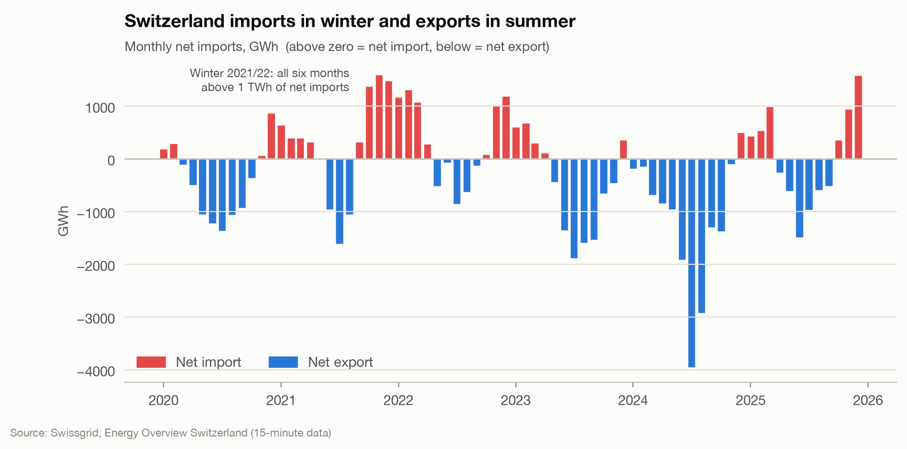
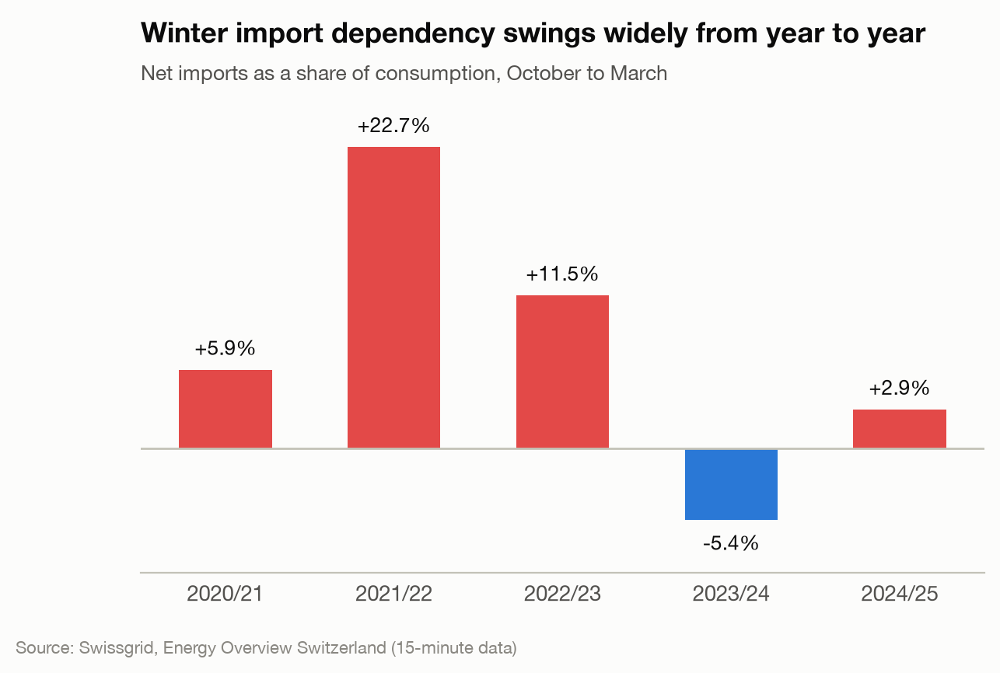
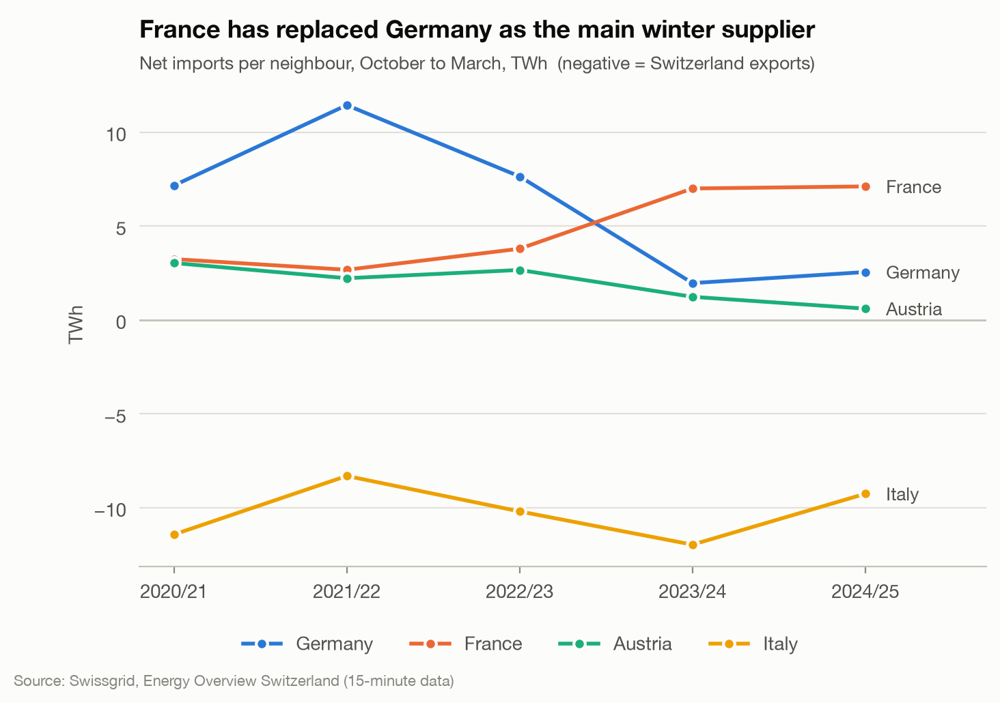
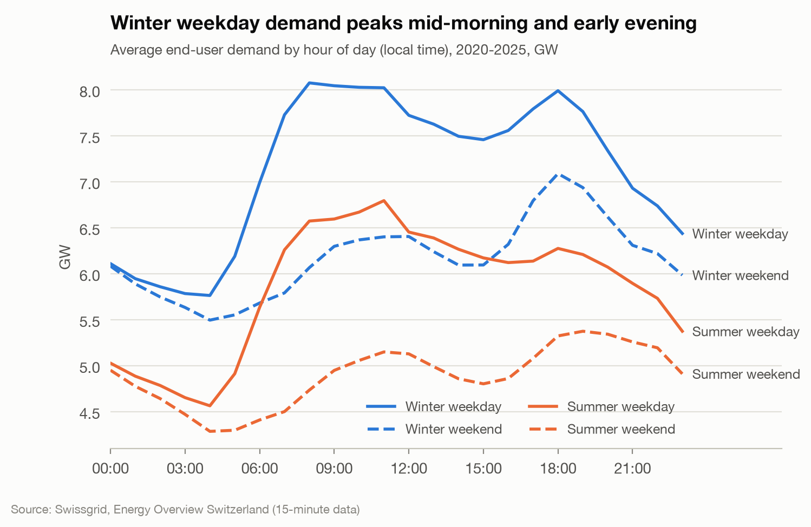
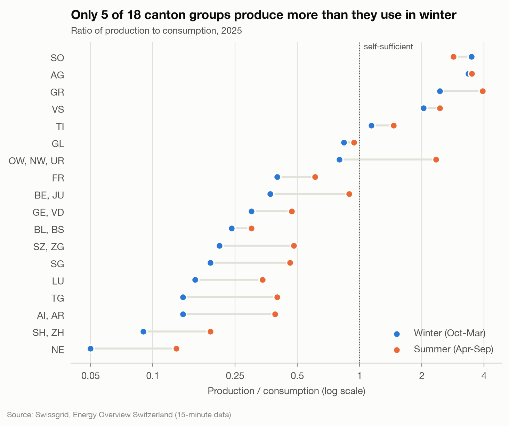

# Switzerland's winter electricity gap

**How much does Switzerland depend on electricity imports in winter, where does that power come from, and how is it changing?**

This project answers these questions with SQL on six years of Swissgrid's 15-minute grid data (2020–2025, 210,000 quarter-hours). It's a small end-to-end data pipeline: a Python download step, a cleaning and loading step into DuckDB, an analysis layer written in SQL, and charts. A test suite checks the data.



## Key findings

**1. Switzerland is a net exporter in summer and usually a net importer in winter.** Hydropower peaks with the snowmelt from May to August, while demand peaks in winter. Over a full year the balance is close to zero, but it varies a lot: from a 3.9 TWh net import in 2022 to a 13.9 TWh net export in 2024, a year with very high hydro output.

**2. Winter import dependency varies widely from one year to the next.** Net imports covered **22.7 % of winter consumption in 2021/22**, but in **2023/24 Switzerland was a net exporter even in winter** (−5.4 %). The most recent complete winter (2024/25) is close to balanced at +2.9 %.

| Winter (Oct–Mar) | Production TWh | Consumption TWh | Net import TWh | Import share |
|---|---:|---:|---:|---:|
| 2020/21 | 32.17 | 34.14 | 2.00 | 5.9 % |
| 2021/22 | 27.31 | 35.30 | 8.02 | 22.7 % |
| 2022/23 | 29.96 | 33.84 | 3.89 | 11.5 % |
| 2023/24 | 34.93 | 33.14 | −1.78 | −5.4 % |
| 2024/25 | 32.62 | 33.59 | 0.99 | 2.9 % |



**3. France has replaced Germany as the main winter supplier.** Germany delivered 11.4 TWh net in winter 2021/22 but only about 2–2.5 TWh in the last two winters. Net flows from France roughly doubled to about 7 TWh over the same period. Italy is consistently the largest net *buyer* of Swiss power (8–12 TWh every winter).



**4. Demand peaks on winter weekday mornings, and at those moments Switzerland usually exports.** 77–100 % of each year's top 1 % demand quarter-hours fall in December–February, mostly on weekday mornings. During those peaks Switzerland was on average a *net exporter* in every year studied. Flexible hydropower appears to run hardest exactly when demand and prices are highest across Europe.

| Year | Top-1 % threshold (MW) | Peaks in Dec–Feb | Net import share at peaks | Net import share otherwise |
|---|---:|---:|---:|---:|
| 2020 | 8,926 | 92 % | −18.6 % | −9.0 % |
| 2021 | 9,196 | 85 % | −3.6 % | +3.5 % |
| 2022 | 9,149 | 100 % | −10.2 % | +4.9 % |
| 2023 | 8,939 | 92 % | −28.4 % | −11.5 % |
| 2024 | 8,967 | 86 % | −24.1 % | −25.6 % |
| 2025 | 8,915 | 77 % | −15.9 % | −1.0 % |



**5. Production is concentrated in a few cantons.** In 2025 only five of the 18 canton groups reported by Swissgrid produced more than they consumed in winter: SO and AG (nuclear plants), and GR, VS and TI (alpine hydro). In winter the large urban areas (ZH/SH, GE/VD, BS/BL) produce less than a third of what they use. Central Switzerland (OW, NW, UR) produces more than twice its consumption in summer but falls short in winter, consistent with snowmelt-driven hydropower.



## How it works

```
Swissgrid Excel files ──► pipeline/download.py ──► data/raw/*.xlsx
                                                        │
                          pipeline/load.py  ◄───────────┘   clean, fix timestamps, reshape
                                │
                                ▼
                     data/swiss_power.duckdb
                     ├── grid_15min      (national totals + cross-border flows)
                     ├── canton_15min    (production/consumption per canton group)
                     ├── grid            view: calendar fields, winter label, net imports
                     └── flows_long      view: UNPIVOT of flows by country & direction
                                │
                     sql/01–06_*.sql   ──►  analysis/report.py ──► results/*.csv, figures/*.png
```

### The SQL

| File | Question | Techniques |
|---|---|---|
| [`00_views.sql`](sql/00_views.sql) | Reusable analytical layer | views, `CASE` calendar logic, `UNPIVOT` |
| [`01_monthly_balance.sql`](sql/01_monthly_balance.sql) | Monthly production, consumption and net imports | aggregation |
| [`02_winter_import_share.sql`](sql/02_winter_import_share.sql) | Import dependency per winter and change vs. the previous winter | CTE, completeness filter, `LAG` window function |
| [`03_flows_by_country.sql`](sql/03_flows_by_country.sql) | Net flows per neighbour, ranked | joins, conditional sums, `RANK() OVER (PARTITION BY …)` |
| [`04_daily_load_profile.sql`](sql/04_daily_load_profile.sql) | Typical day, winter vs. summer, weekday vs. weekend | grouping on derived dimensions, unit conversion |
| [`05_peak_demand.sql`](sql/05_peak_demand.sql) | When do the top 1 % demand hours occur, and is Switzerland importing then? | `PERCENT_RANK`, `FILTER` aggregates |
| [`06_canton_self_sufficiency.sql`](sql/06_canton_self_sufficiency.sql) | Which regions are net producers, by season | CTE, join, `PIVOT` |

### Data engineering details

- **Timestamps.** Swissgrid labels intervals in Swiss local time. Until 2024 the label marks the *end* of each interval; from 2025 it marks the *start*. Daylight saving time also creates a skipped hour in March and a repeated hour in October. The loader doesn't parse these ambiguous labels. Each file is a complete 15-minute series for one calendar year, so the loader derives an unambiguous UTC timestamp from the row position and uses the labels only as a cross-check. The load fails if fewer than 99.9 % of labels match.
- **Mixed formats.** Older files store real Excel dates and newer ones store `dd.mm.yyyy hh:mm` strings. Both are handled.
- **Tests** ([`tests/`](tests)): unit tests for the timestamp logic (leap years, 92- and 100-interval DST days, both label conventions), and data-quality tests on the built database:
  - every year is complete
  - no gaps or duplicate timestamps
  - no nulls or negative values
  - the long and wide flow tables agree
  - **the energy balance closes**: production + net imports = consumption to within 0.1 % every year
- **CI** runs the unit tests, then the full pipeline on the two most recent years.

## Run it yourself

Requires Python 3.10+.

```bash
git clone <this repo> && cd swiss-power-balance
make setup      # create .venv and install requirements
make all        # download (~150 MB) → load → report → test
```

You can also run each step on its own: `make download`, `make load`, `make report`, `make test`. To choose the years: `.venv/bin/python -m pipeline.download 2022 2023 2024 2025`.

To query the database directly:

```bash
.venv/bin/python -c "import duckdb; print(duckdb.connect('data/swiss_power.duckdb').sql('SELECT * FROM grid LIMIT 5'))"
```

## Caveats

- **Physical flows, not trades.** Cross-border values are physical flows measured at the border. Part of the power flowing from France and Germany to Italy only passes through Switzerland (transit), which inflates both the import and export figures per country. Net totals are not affected.
- **Consumption** here is Swissgrid's "total consumption of the Swiss control block". It includes grid losses and the electricity used by pumped-storage plants, so it is higher than end-user demand. The daily profile and peak analysis use end-user consumption.
- **Canton figures** exclude plants that Swissgrid reports as "across cantons" or "foreign territories". Canton groups (e.g. "GE, VD") are as published by Swissgrid.
- Recent data may still be revised by Swissgrid.

## Data source

[Swissgrid – Energy Overview Switzerland](https://www.swissgrid.ch/en/home/operation/grid-data/generation.html), 15-minute time series for the Swiss control block. The raw files are not stored in this repository; `make download` fetches them.
